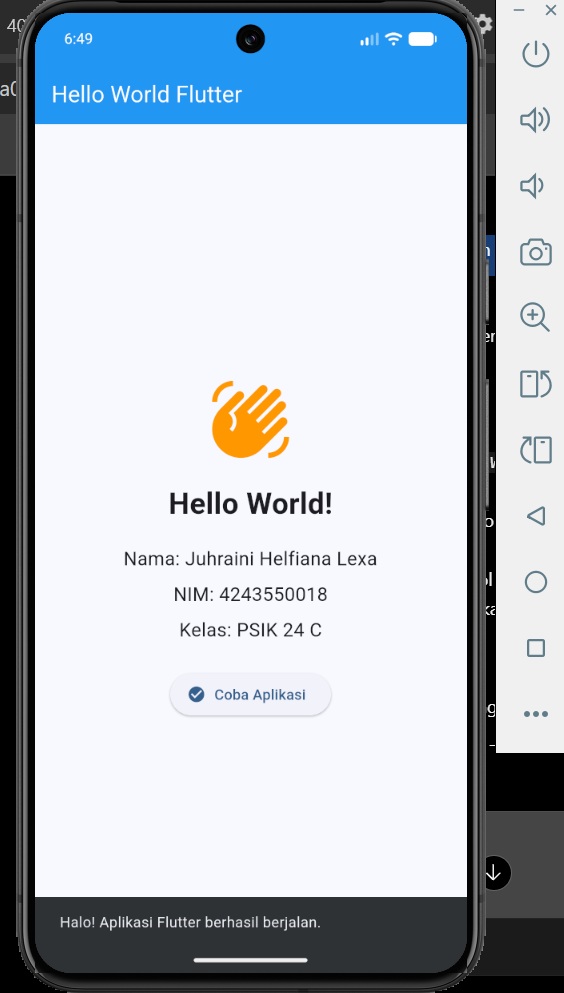

# Tugas Pertemuan 1 — Pemrograman Mobile

## Identitas Mahasiswa

- **Nama:** Juhraini Helfiana Lexa
- **NIM:** 4243550018
- **Kelas:** PSIK 24 C
- **Mata Kuliah:** Pemrograman Mobile

## Deskripsi Aplikasi

Aplikasi ini dibuat menggunakan Flutter dan bahasa pemrograman Dart sebagai tugas pertemuan pertama mata kuliah Pemrograman Mobile.
Aplikasi menampilkan teks Hello World, nama mahasiswa, NIM, kelas, ikon, dan tombol interaktif. Ketika tombol **Coba Aplikasi** ditekan, aplikasi menampilkan pesan bahwa aplikasi Flutter berhasil berjalan.

## Teknologi yang Digunakan

- Flutter
- Dart
- Visual Studio Code
- Android Emulator

## Versi Flutter

Jalankan perintah berikut untuk melihat versi Flutter yang digunakan:

```bash
flutter --version
```

*Lengkapi bagian ini menggunakan hasil perintah pada komputer.*

## Bukti Pemeriksaan Environment

Jalankan perintah berikut:

```bash
flutter doctor
```

Lampirkan screenshot hasil pemeriksaan Flutter Doctor pada bagian ini.

## Screenshot Aplikasi

Simpan screenshot aplikasi yang berhasil dijalankan pada folder `screenshots/`, lalu tampilkan menggunakan:

```markdown

```

## Kendala dan Solusi

### 1. Versi NDK Tidak Sesuai

**Kendala:** Konfigurasi proyek Flutter mengharapkan versi Android NDK yang berbeda dari versi yang tersedia pada komputer.

**Solusi:** Menyesuaikan konfigurasi `ndkVersion` pada file `android/app/build.gradle.kts` dengan versi NDK yang tersedia, kemudian menjalankan `flutter clean` dan `flutter pub get`.

### 2. Peringatan Format Baris Git

**Kendala:** Git menampilkan peringatan bahwa format baris LF akan diubah menjadi CRLF pada beberapa file.

**Solusi:** Memahami bahwa pesan tersebut merupakan peringatan perbedaan format baris pada Windows, bukan kegagalan commit. Proses commit tetap berhasil.

## Perbandingan Native, Hybrid, dan Cross-platform

Pengembangan aplikasi mobile dapat dilakukan dengan pendekatan native, hybrid, dan cross-platform. Aplikasi native dibuat khusus untuk satu sistem operasi menggunakan teknologi yang sesuai, misalnya Kotlin untuk Android atau Swift untuk iOS. Pendekatan ini memberikan akses yang baik terhadap fitur perangkat dan dapat menghasilkan performa optimal, tetapi pengembang perlu membuat dan memelihara kode yang berbeda untuk setiap platform.
Aplikasi hybrid umumnya menggunakan teknologi web seperti HTML, CSS, dan JavaScript yang dijalankan dalam wadah aplikasi mobile. Pendekatan ini memungkinkan penggunaan kembali kode web, tetapi performanya dapat bergantung pada teknologi pembungkus dan kebutuhan aplikasi.
Sementara itu, cross-platform memungkinkan pengembang menggunakan satu basis kode untuk membangun aplikasi pada beberapa sistem operasi. Salah satu contohnya adalah Flutter, yang menggunakan bahasa Dart dan menyediakan widget untuk membangun antarmuka aplikasi. Pendekatan ini dapat menghemat waktu pengembangan dan mempermudah pemeliharaan kode. Namun, pengembang tetap perlu memperhatikan kebutuhan khusus setiap platform dan integrasi fitur perangkat.
Menurut saya, cross-platform seperti Flutter cocok untuk pembelajaran dan pengembangan aplikasi yang menargetkan beberapa platform dengan sumber daya terbatas. Pemilihan pendekatan tetap perlu disesuaikan dengan kebutuhan performa, fitur, biaya, dan kemampuan tim.

## Deklarasi Penggunaan AI

Saya menggunakan ChatGPT sebagai alat bantu untuk memahami langkah konfigurasi Git, menyusun dokumentasi README, dan mengatasi kendala selama pengerjaan. Kode, pengujian aplikasi, dan hasil akhir diperiksa kembali agar sesuai dengan tugas yang dikerjakan.

## Riwayat Commit

Riwayat perubahan proyek dapat dilihat melalui GitHub setelah repositori dipublikasikan.
